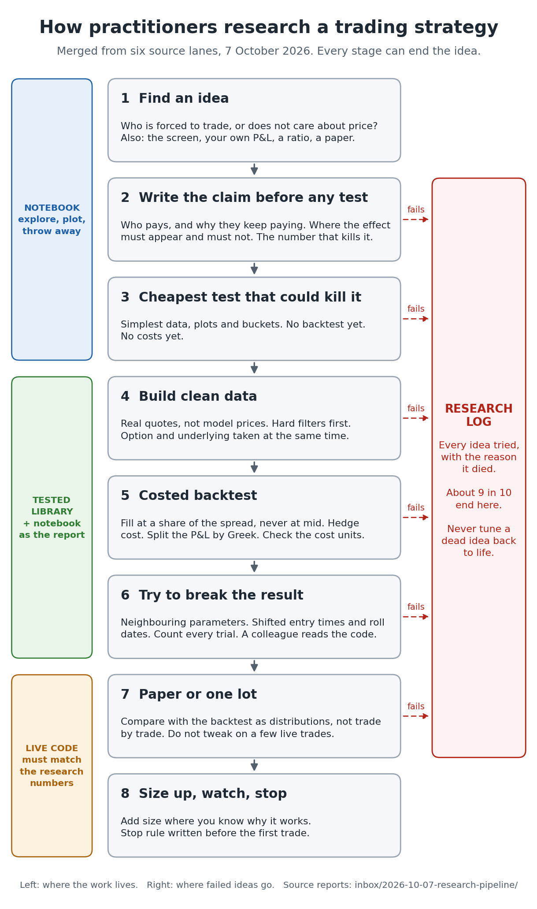

# How practitioners research a trading strategy

> Staging note, 2026-10-07. Merged from the six lane reports in this folder. Not canon: nothing here is promoted to `domain/`.

## How to read this page

This page describes the process that people follow, from the first idea to real money. It is a map. Each claim on it comes from a lane report in this folder, and the lane report holds the link, the date, the quote and a label for who said it. Read the lane report when you want the evidence for a line.

| Lane report | Sources read | State |
|---|---|---|
| [reddit.md](reddit.md) | 56 threads | finished |
| [qse-forums.md](qse-forums.md) | 42 | finished |
| [blogs.md](blogs.md) | 34 | finished |
| [papers-tooling.md](papers-tooling.md) | 39 | finished |
| [podcasts.md](podcasts.md) | 28 episodes | finished; written up from the first workers' notes with no second reading |
| [youtube.md](youtube.md) | 13 talks | finished, but short: 25 to 30 talks were planned, and 5 of the 13 are by one person |

Three short answers to what you asked, each expanded below:

- **Where hypotheses come from.** Most often from a participant who must trade and does not care about the price. Then from watching the screen and one's own profit and loss. Papers and ratio screens come after those.
- **Do they check ratios.** Yes, many ratios. But every experienced source says a ratio only tells you where to look. It becomes a hypothesis when you can name who is on the other side and why.
- **How they use notebooks.** For exploration and for the final report. Code that is used twice moves into a tested library. No source defends untested logic that lives only in a notebook.

## Stage 1 — Find an idea

The sources name the same few origins of ideas. The table ranks them by how many lanes and how many experienced people name each one.

| Source of ideas | Who names it | The warning that comes with it |
|---|---|---|
| A participant who is forced to trade or ignores price: index funds, call-selling ETFs, structured-product hedgers, pension put-selling programmes, retail option buyers | Every lane. Ten people on Reddit; Eifert, Karsan, Krishnan, Abdelmessih, Sinclair, Longmore; the paper by Gârleanu, Pedersen and Poteshman | A flow is not constant. When too many sellers arrive, the premium goes to zero (Eifert) |
| Watching the screen and your own trades | Market makers on Reddit; Lindstrom, who studies the volatility surface every minute and a half and asks why each kink is there; Karsan, whose idea came from explaining his own losses | Hard to learn alone. Several say a good desk is where it is taught |
| Ratio screens and relative value | Abdelmessih, Sinclair, ORATS, Bennett, Goyal and Saretto, Elite Trader option traders | A screen is a start, not a test. See the list below |
| Papers | Sinclair searches SSRN every week and follows citations; Quant StackExchange answers; Chan | You read dozens to find one. Use the observation, not the trade. A 0DTE market maker says he has read none since college. Papers lag the industry by years |
| Other people | A friend's live trade (the Indian options book); a small trusted group; old floor traders | Check what they do, not the reasons they give (Sinclair) |
| Known risk premia: being paid for something unpleasant | Sinclair, Longmore | A premium can last a career, but the returns are small and the bad days are large |
| Starting from the data | One options desk fits linear, then quadratic, then non-parametric shapes; López de Prado | Disputed. See "Where practitioners disagree" |

Almost no experienced source recommends indicator libraries, retail trading videos, vendor demo notebooks, or ideas generated by a language model.

**How they find the forced participant.** They ask dealers and brokers what is being sold and to whom. They read public documents: index rules, ETF prospectuses, fund mandates. They compare the size of the flow with the daily volume of the market it must trade in. One former index market maker kept a spreadsheet of thousands of large positions (he now sells a tool, so weigh that).

**The ratios they screen.** Abdelmessih reduces an option chain to four comparisons, and sets each one against other assets and against its own history:

- the straddle: implied volatility against realised volatility;
- the vertical spread: skew;
- the strangle: the price of the tails;
- the time spread: term structure.

Sinclair screens ratios between related series: one index's volatility against another's, VIX against VVIX, VIX against at-the-money volatility. Goyal and Saretto sort stocks on historical minus implied volatility. ORATS compares each number with the stock's peers, with a forecast, and with its one-year range.

**Traps in ratio screens**, each named by a practitioner:

- High implied volatility alone is not a reason to sell. It is often high for a cause.
- VIX minus realised volatility is the wrong comparison. VIX is built from the whole strip of options and sits several points above at-the-money volatility. Compare at-the-money implied with realised (Eifert).
- An implied volatility is a forecast for the next 30 days. Compare it with the volatility that came after it, not before it.
- In one retail study a wide gap between implied and historical volatility gave worse results, because the gap was widest while implied volatility was still rising.

**One classification to make at once.** Sinclair sorts every idea into a risk premium (someone pays for insurance; it can last) or an inefficiency (the market has not noticed; it ends when others notice). You trade the first carefully for a long time and the second hard for a short time.

## Stage 2 — Write the claim before any test

The sources agree on what is written down before data is opened.

- **Who pays, and why they will keep paying.** Longmore asks for three sentences: what causes the mispricing, why you can take it when faster firms have not, and how you would trade it. One Reddit answer lists four kinds of payer: paid for risk they cannot spread, forced, constrained, or paying for speed.
- **Where the effect must appear and where it must not.** If month-end rebalancing is the reason, the effect must be at month end and absent in the second week. These side predictions are tests you did not tune.
- **The number that ends the idea.** "It must beat X by Y or it is dead", written before the run.
- **What is unpleasant about the edge.** If nothing is, a larger firm already has it (Longmore).

For options, three more habits appear. State the trade as a relative claim: "I buy this because that is priced higher" (Abdelmessih). Separate the effect from the structure: find the edge first, choose the option structure second (Sinclair). Compare against the simplest alternative with the same return: Israelov tests put protection against simply holding less stock.

Funds do the same in a formal way. Man AHL makes researchers write the data split, the method and the expected result in advance. Harvey calls this pre-registration.

## Stage 3 — The cheapest test that could kill it

Experienced people do not start with a backtest. A backtest contains many arbitrary choices, so a good result proves little. They first ask what they would see in simple data if the idea were true, and what they would see if it were false.

Longmore's example is the clearest. The line "realised came in under implied, so sell" hides an assumption: that options which were expensive stay expensive. He tests that one assumption on public data, with no strategy and no costs. A crypto desk head puts it as: the research is what you do before you run the backtest. On Reddit the most-voted habit is to plot everything and average by bucket. Sinclair shows an effect in its plainest form with round numbers and looks at the chart before any statistic.

For options, one desk drill comes before any code: hedge a single option by hand in a spreadsheet and find the volatility at which it breaks even.

One check is cheap enough to do here even though costs come later: express the edge and the bid-ask width in the same unit. An edge of 0.2 volatility points cannot be collected through a market 0.5 points wide (a 0DTE market maker on Reddit).

## Stage 4 — Build clean data

- **Use real quotes.** Option prices rebuilt from VIX and a model produce edges that never existed.
- **Filter hard errors first**: zero bids, crossed or locked quotes, stale quotes, prices near intrinsic value. Statistical outlier removal comes after, if at all.
- **Match the clock.** Some vendors record the option and the underlying at different times. Vendors that care take a snapshot about 15 minutes before the close, because closing quotes are poor.
- **Take the forward from the options** by put-call parity. It is also a check on your data.
- **Distrust a result that is too good.** One trader's profitable test came from a volatility series that had been divided by 100 partway through.
- **Keep raw data unchanged** and build everything else from it.

For Indian options, Reddit users report that brokers drop expired contracts, so history is bought from an exchange-authorised vendor or collected daily. They also say a backtest must use the lot size of each date, and that one-minute bars cannot tell you whether the stop or the target was hit first. I did not check their vendor prices.

## Stage 5 — The costed backtest

The Indian options book describes two steps: a fast rough prototype, then an event-by-event simulator that runs the same strategy code as production.

- **Never fill at the mid price.** A data vendor charges 75% of the spread for one leg, falling to 53% for four legs. One trader assumes "normal, bad and horrific" fills. A Reddit poster reports live SPX 0DTE fills about 40% of the way from mid to the far side.
- **Count the hedge.** Daily re-hedging pays the underlying's spread about twenty times a month (one Quant StackExchange reply).
- **Split the profit by Greek**: what came from gamma, from vega, from theta. If you cannot explain the profit, do not add complexity.
- **Enter on every qualifying day**, so one lucky start date does not decide the result.
- **Check units.** A published 0DTE study charged the spread at one hundredth of its size. After the fix, no strategy stayed profitable after costs.
- **Do not rank structures that carry a direction.** A call spread that won in a rally shows the rally.

What a backtest is for, according to these sources: to confirm an idea you already have, to compare two versions on the same engine, and to see how the result changes with each cost assumption. Trust the difference between two runs more than the level of either.

## Stage 6 — Try to break the result

- **Neighbours.** A real effect works at nearby settings: other deltas, other expiries, other indices. An effect that works at 9:20 and not at 9:30 is luck (Sinclair). The Indian options book averaged over stable regions of parameters and dropped anything that worked at one setting only.
- **Shifted dates.** Hoffstein ran the same option strategy on three roll schedules. Any two versions drifted apart with a tracking error of more than 4% a year.
- **Data you have seen is used up.** Any choice made after looking at a result is a fit (Carver, Sinclair). A held-back sample works once.
- **Count every trial.** With five years of data, trying more than about 45 configurations makes a false result likely (Bailey and co-authors). A parameter cell plus one saved output notebook per run gives an honest count.
- **Test where you know the answer.** Run the method on simulated prices with no edge in them (Israelov, Carver, Chan).
- **Split by regime**, for example by VIX level (Sidial).
- **Check for future data.** Cut the data at a past date and recompute; every earlier value must be identical.
- **Have someone else read it.** Man AHL gives each idea two reviewers, one from another team, with the pass mark agreed before the held-back data is opened. Two Reddit researchers at options market makers describe code review, and a defence of the research, before release.

For short-option strategies, a Sharpe ratio flatters the result because losses are rare and large. Use stress tests as well. Sinclair adds: prefer trades that give feedback quickly, because a far out-of-the-money condor wins too often to tell luck from skill.

## Stage 7 — Paper or one lot

The sources split on paper trading (see the table of disagreements). They agree on the rest.

- **Compare as distributions.** Live results should fall inside the backtest's mean and spread, not match trade by trade. Sinclair uses a formal test for this; an older forum trader uses control charts.
- **Replay each live day through the backtest** and explain every gap. Several independent sources call this underused.
- **Production must reproduce the research numbers exactly** on sample inputs before it trades (Jane Street).
- **Do not tweak after a month live.** That replaces a rule built on a thousand observations with one built on twenty (Sinclair).

## Stage 8 — Size up, watch, stop

Size follows understanding. The Indian options book added size to what worked and was understood, and removed what failed and was not understood. Sinclair grades his belief in an effect from 0 to 10 and gives new ideas about 5% of his account. A stop rule is written before the first trade and is based on the strategy's own expected drawdown. Edges decay, partly because trading them improves the price (Jacobson).

## The research log

About nine ideas in ten die. The figure comes from one options-desk researcher's first two years; other reports are 4 survivors from 600 and none from 80. Ron Minsky of Jane Street says that in research most ideas are bad.

People who last keep a record: what was tried, on which data, and why it died, grouped by the kind of failure. Some keep a daily profit series for each dead idea, so that a new idea can be compared with the old ones. One firm still computes a rejected signal to see how it does later. Carver publishes his: of 17 studies, 7 were put into use. A failed idea is not adjusted until it passes.

Time for one idea: under a week for an intern at a trading firm with a clear question; a few weeks at a firm with a one-week kill rule; two to three months to find and the same to test for a part-time trader.

## Notebooks

**What firms do.** At Jane Street, Python notebooks are for research and the code is treated as disposable. Anything that must last goes into a typed, tested language. Their stated problem with notebooks is hidden state: cells run in any order, so the page may not match what a clean run would give. The cure they name is to restart and run from the top.

**When code leaves the notebook.** The signs are: you copy an old notebook to start a new one, you paste a function between notebooks, or you write a class in a cell. Code used twice becomes a module with tests. The notebook then calls the library and stays short and linear.

**Layout.** One practitioner layout has seven parts: imports, own modules, parameters, data loaders, settled functions, a main cell, working cells. A bank's public options notebook has six: summary, setup, build the position, price it through history, split the profit into parts, verdict. A common folder split is `exploratory/` and `reports/`.

**Reproducibility.** Restart and run all before sharing. Pin versions. Keep a plain-text copy of each notebook for review. Mark one cell as parameters and save a new output notebook for every run. In a study of public notebooks, a quarter ran and 4% gave the same result.

**Two opposite views.** Robot Wealth runs the whole study in hosted notebooks, in a shared repository, reviewed like code. Sinclair says to work on paper and a spreadsheet for as long as possible and automate late. The public options research that outsiders have checked uses scripts with one entry point and no notebooks; the public options notebooks are demonstrations with no step that could kill the idea.

**Writing with an AI assistant.** Read every line. Reddit and Quant StackExchange both report assistants that leak future data into a test without any visible sign.

## Where practitioners disagree

| Question | One side | Other side |
|---|---|---|
| Reason first, or data first? | Reason first: Arnott and Harvey, Sinclair, Longmore, Karsan, Carver | Data may lead if tested afterwards: López de Prado, one options desk on Reddit |
| Does a story protect you? | Without a story it is only correlation | People can explain any pattern after the fact |
| Correct for the number of trials? | Yes, always: Bailey, Harvey, López de Prado | Carver dislikes it; Hoffstein says a missed edge costs more than a false one; Sinclair: "a hunter, not a scientist" |
| Is walk-forward testing out-of-sample? | Yes, with enough data | No: once you edit after seeing it, it is used |
| Paper trading | Run paper beside live; 6 to 12 months first | "Paper trading won't help you": trade one lot (Sinclair) |
| When do costs enter? | After the effect is understood (Longmore) | Before any backtest (Chan); for hedged options they may decide the result |
| Is an options backtest worth it? | Yes, with real quotes and bad fills | It is one path of many; model it and test small and live |
| Can dealer positions be known? | Karsan builds them from broker flow | Curnutt and Sinclair doubt the usual assumptions |
| Stops on option trades | Sun fixes the loss with a stop and builds the trade around it | Sinclair: a trade you must stop out of was the wrong size; exit when the edge is gone |

## How far to trust this page

- **I checked little of it myself.** I opened six main sources and confirmed the quotes, and confirmed that three main Reddit threads exist. Everything else rests on the workers' reading.
- **The agreement is narrower than it looks.** Sinclair appears in five lanes and gives 5 of the 13 YouTube talks. Sinclair, Longmore and Abdelmessih publish on one another's sites. Count them as one school.
- **The strongest options voices on Reddit are anonymous**, and their track records are their own statements.
- **Sellers are in the evidence**: ORATS, spintwig, tastylive, QuantConnect, VolSignals. The lane reports label each one.
- **Some books were not opened.** Sinclair's book was read through another person's notes, Bennett's in extracts, Natenberg's not at all.
- **Gaps.** The Wilmott and NuclearPhynance forums were mostly unreachable. Indian YouTube channels were not covered, and six planned talks were never read; [youtube.md](youtube.md) lists them. No podcast guest and no talk showed how a research notebook is laid out, so the notebook section rests on the forums, Reddit and the tooling sources. Evidence specific to options is thin for stage 7 and for kill rates.
- **The podcast file had three writers.** A launch fault ran three workers on it at once. A later worker merged their notes; where two notes gave different timestamps for one passage, both are shown.

## Read these first

1. [Sinclair, "Finding Edges"](https://robotwealth.com/finding-edges/) — one page on where ideas come from.
2. [Sinclair quoted on Moontower](https://moontower.substack.com/p/hard-earned-trading-wisdom) — data seen is used up; grading belief; manual before automated.
3. [Longmore's case study](https://moontower.substack.com/p/case-study-on-becoming-a-partner) — the implied-against-realised example, tested without a backtest.
4. [Elite Trader, "How to research and verify trading ideas"](https://www.elitetrader.com/et/threads/how-to-research-and-verify-trading-ideas.181368/) — pages 1 to 3: reason, statistics, then equity curve.
5. [Reddit AMA, an Indian weekly index-options book](https://www.reddit.com/r/quant/comments/1okr5l7/) — the full path from idea to production. Anonymous.
6. [Reddit AMA, a 0DTE market-making trader](https://www.reddit.com/r/quant/comments/1mk0za3/) — the edge-against-width test. Anonymous.
7. [Eifert, "Bad Ideas"](https://www.flirtingwithmodels.com/episodes/If53y6iMsVe) — the wrong and right way to measure the volatility premium.
8. [Sinclair's talk to RDU Traders](https://www.youtube.com/watch?v=WB8t4WrdR3I) — how to show an effect in its simplest form.
9. [Carver, the three kinds of overfitting](https://qoppac.blogspot.com/2015/11/the-three-kinds-of-overfitting.html).
10. [Man AHL, "Overfitting and Its Impact on the Investor"](https://www.man.com/insights/overfitting-and-its-impact-on-the-investor) — a fund on its own records and written plans.
11. [Vilkov's 0DTE replication package](https://github.com/vilkovgr/0dte-strategies) — the layout of a checked options study, and the cost error that reversed it.
12. [Signals and Threads, episode 5](https://signalsandthreads.com/python-ocaml-and-machine-learning/) — how a trading firm keeps research notebooks apart from lasting code.
